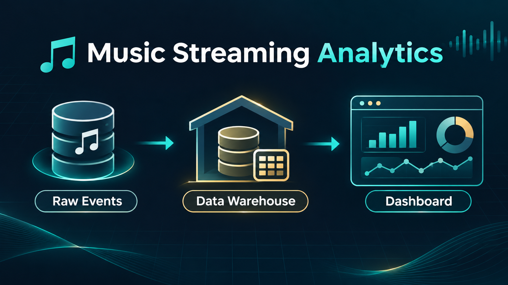
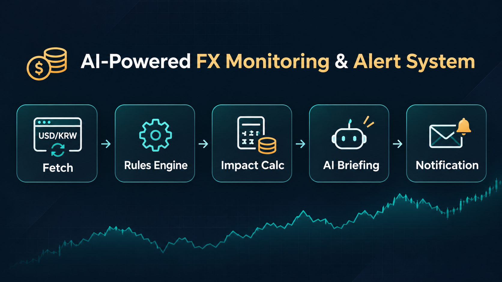
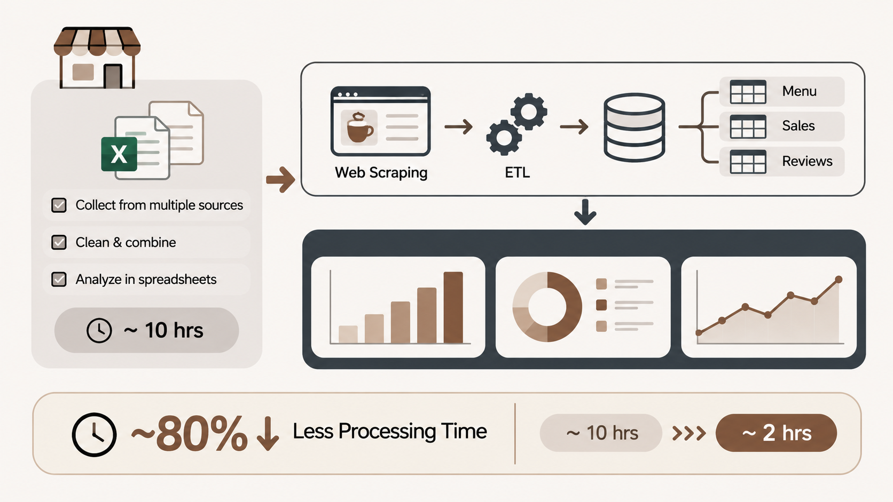
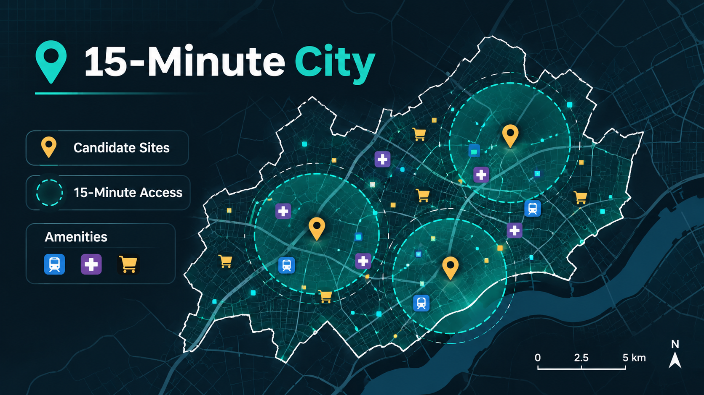

   

<h1 align="center">
  Hi, I'm Hyunseo (Leia) Kim 👋
</h1>

  <b>Data Engineering · Analytics Engineering · Applied Data Science</b>

  M.S. in Applied Data Science at the University of Southern California (USC), Class of 2027.
   
  Previously worked at <b>KakaoPay</b> and <b>Warner Music Group</b>,
  with experience in data governance, analytics, and workflow automation.
   
  Passionate about building reliable data pipelines and
  transforming complex data into actionable business insights.

---

<h2 align="center">Featured Projects</h2>

  Data Engineering · Analytics · Automation · Machine Learning

<table>
<tr>
<td width="50%" valign="top">

<h3>🎵 Music Streaming Analytics</h3>

 

<b>Tech:</b> Python, SQL, PostgreSQL, dbt, Tableau

Transformed <b>21M+ raw music listening events</b> into
analytics-ready datasets, enabling reliable streaming
performance analysis and business reporting with
data quality validation.

</td>

<td width="50%" valign="top">

<h3>💰 AI-Powered FX Monitoring & Alert System</h3>

 

<b>Tech:</b> Python, REST APIs, GitHub Actions, Claude API

Automated USD/KRW monitoring with <b>duplicate-resistant
alerts</b>, API fallback, and AI-generated, source-backed
explanations of exchange rate movements.

</td>
</tr>

<tr>
<td width="50%" valign="top">

<h3>☕ Digital Transformation for Cafe Nogwon</h3>

 

<b>Tech:</b> Python, SQL, Selenium, BeautifulSoup, pandas

Automated data collection, processing, and analysis
for a real-world cafe, <b>reducing end-to-end
processing and analysis time by ~80%</b>.

</td>

<td width="50%" valign="top">

<h3>🌍 15-Minute City: Public Housing Site Selection</h3>

 

<b>Tech:</b> Python, GeoPandas, OSMnx, Folium

Developed a <b>geospatial decision-support prototype</b>
to evaluate public housing candidate sites based on
accessibility to essential services and urban infrastructure.

</td>
</tr>
</table>

 

<h2 align="center">
   <b>🛠️ Technical Skills</b>
</h2>

  <b>Languages</b>

  
  
  

  <b>Data Engineering & Databases</b>

  
  
  
  

  <b>Machine Learning & Analytics</b>

  
  
  
  
  

  <b>Developer Tools</b>

  
  
  
  
  

---

<h2 align="center">Connect with Me</h2>

  

  

